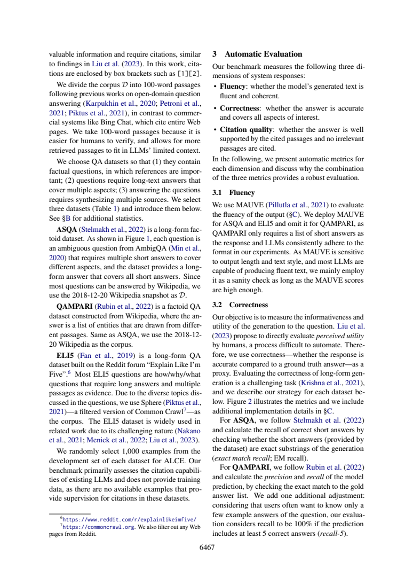

# Recall达到100%，为什么仍可漏掉答案

这份分享解决一个具体的论文阅读问题，采用“先冻结问题与验收标准→编号原文→真实AI回答→严格定位→语义核查”的流程。范围、任务和作者判断在下文明确分开；不是对原论文实验的复现，也没有宣称模型、提示词或工作流普遍更优。此前我在同项目阅读过这两篇论文；本次主题与既有query位置干预文章不同，实际调用也是新产生的。

## 阈值改变了满分的含义

ALCE §2与§3.2，物理页2–3（6466–6467）区分ASQA长文本答案与QAMPARI实体列表。ASQA需要覆盖歧义问题的多个短答案，使用金标准短答案是否出现在生成中的EM recall。QAMPARI回答是一组从不同passages取得的实体，precision/recall以和gold列表的精确匹配为基础，但recall额外作阈值调整：预测中至少5个正确答案就记100%，称recall-5，理由是用户常只需要几个示例。



一个教学例子足以说明“满分”的边界。设gold有10个不同实体，预测5个不同实体且全对：普通recall=5/10=50%，precision=5/5=100%，按上述至少5正确规则recall-5=100%。这不是论文新实测，也未执行官方评测器；它仅检验定义的逻辑后果。不要借这个简例推断重复实体、别名、gold少于5时的官方代码行为，所供两页没有完整实现细节。

|指标|示例结果|满分能说明什么|
|---|---:|---|
|普通recall|50%|gold覆盖了一半|
|recall-5|100%|达到至少5个正确示例阈值|
|precision|100%|本示例给出的5项均正确|

这里的precision是实体答案列表的precision，不是citation precision；recall-5也不是“只查5条引用”。同一篇论文里相同词根可能对应完全不同对象，报告指标时应同时写数据集、对象、匹配规则和阈值。

## 新调用核查

原答D2正确解释阈值，D3清楚标出教学示例并算出50/100/100，D4没有把100%说成穷尽全部答案。D1却主要讨论指标分母，没有按题目明确对照QAMPARI“实体列表”和ASQA“覆盖多种解读的长答案”，且其所引§3.2范围不支撑全部数据集构造描述，应连读页3的ASQA/QAMPARI段落和页2 Table1。

D4说EM recall“要求金标短答逐一匹配”，需理解为逐项判断再算比例；它不要求生成必须命中所有项才有非零分。只有100% EM recall才表达按该匹配规则覆盖全部gold短答案。模型提醒少于5/重复/别名边界未覆盖是合理限制，不能把它们凭空补成本文实测。这个案例提供的是读指标阈值的办法，没有跨数据集统一排名或稳定提升声称。

## 真实记录与复做

本次一轮Bohrium CLI2.8.1原生调用，请求gpt-5-mini/photon，实际返回chenkun/gpt-5-mini。无历史无工具，180秒预算，实际墙钟（含预检及客户端开销）18.483秒，输入2891、输出2477 tokens。completion ID见metadata；精确snapshot/temperature/seed不可得。费用无逐次货币信息，cost=null，不能当0。正文判断由Codex辅助非盲核查，不伪装独立人类评审。

完整[实际输入](run-request.txt)、[预检](run-preflight.json)、[原始响应](run-response.json)、[模型原答](run-output.json)、[元数据](run-metadata.json)、[stderr](run-stderr.txt)均保留。response仅脱敏私人余额。没有重写原答，也没有失败后挑选新答案。本次严格JSON/行范围结果为`ranges_valid`，共6段；这只检查id覆盖、字段存在与行范围，不检测问题语义对应、单位、蕴含或原文是否充分。

本地复查（Python3标准库、无需联网）：

```sh
python validate.py sources.json run-output.json
```

预期状态以validation.json为准；ranges_valid退出0，range_errors/invalid_json退出1，这是保留原答的真实验证结果；请继续逐项比对[编号原文](numbered.txt)、正文审计与[调用前标准](criteria.md)。D1–D4标签存在不表示它们分别答对了问题。

独立重做需从玻尔官方渠道安装Bohrium CLI并手动登录，确保额度。保留这些文件同目录，用原生exe或对应系统原生二进制：

```sh
python replay.py --bohr /absolute/path/to/bohr --condition workflow --out new-run
```

replay先dry-run逐字验证实际message，再调用；现有out拒绝覆盖。Windows .cmd历史上会截断多行参数，原生exe避免这一已遇到的问题；命令行仍需低于Windows长度限制。若代理影响认证，本脚本仅移除子进程HTTP_PROXY/HTTPS_PROXY/ALL_PROXY及小写变量，不修改系统代理。真实输入含非语义UUID，新调用不保证逐字相同，按预先标准核验。失败记录不应删改，网络失败不得伪造成功。

## 文件导航与许可

[task.txt](task.txt)列出确切四项问题；[workflow.txt](workflow.txt)为本次方法；[protocol.md](protocol.md)为运行约束；[protocol-lock.json](protocol-lock.json)记录六个事前文件SHA256（对应本目录同名文件）。[sources.json](sources.json)保留原文页面、物理页和source_id，[SOURCES.md](SOURCES.md)说明作者、版本、页码、原PDF哈希与许可。图是原页核查材料，关键结论都另有文字，不依赖看图取数。

[validate.py](validate.py)是机械检查器；[replay.py](replay.py)保存全新请求与响应。只有本次输入输出进入本作品，未把旧实验重复包装。论文采用CC-BY4.0，原创文字与代码MIT。来源研究归论文作者；本次贡献是具体问题设计、适配编号流程、一次实际玻尔阅读、对原答缺陷的原文核查及可照做教程。
